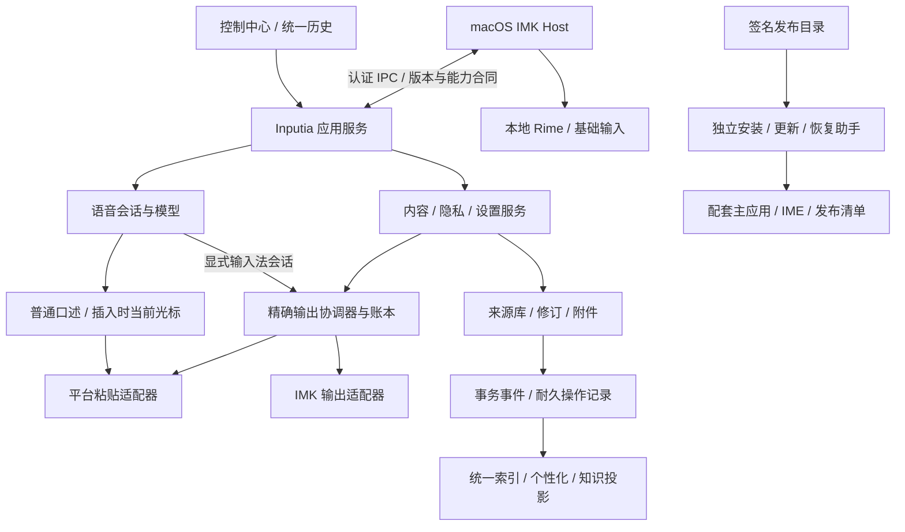

# Inputia

**2026-10-21 本机状态：1.1.25/build113 已安装，用户确认本次试用候选正常出现。** 修复后台字段变更和增强选择失败后基础候选被隐藏，以及权限探针把连接暂失当拒权、ready 回调关闭自身连接的恢复循环。真实生产分支回归、旧版运行反证、权限边界审查及完整成套构建通过；安装后约 30 秒新鲜采样中两组件 ready、IME 代数稳定，词库和设置保留。用户收到原输入框及另一个应用的复测请求后回复“现在候选正常出现”；此确认限定于本次实际试用，未提供具体应用或轮次。本轮停止继续测试和修改输入链路。详见[候选恢复修复记录](docs/verification/2026-10-21-candidate-recovery.md)。

**2026-10-20 本机状态：1.1.24/build112 已安装。** “历史记录”入口改为“录音”，固定显示语音；“剪贴历史”改为“剪切”，剪切页和快捷浮窗按剪贴板来源呈现。55 项专项回归及成套构建通过，实际界面确认录音页不混入复制记录；安装前后已有语音、剪贴记录、录音文件与设置一致。详见[录音与剪切分离记录](docs/verification/2026-10-20-recordings-clipboard.md)。

**2026-10-20 本机状态：1.1.23/build111 已安装。** 为 Qwen3-ASR 增加长录音连续分段和截断有界重试，重转录错误留在对应历史预览内。11 项算法回归、界面回归、独立审查与完整成套构建通过；在实际应用中重转录原有 159.24 秒录音，8 段全部成功，约 4.39 秒生成 717 字符并写回原历史，原 WAV 不变。详见[长录音修复与应用内验证](docs/verification/2026-10-20-long-recording.md)。

**2026-10-20 本机状态：1.1.22/build110 已安装。** 修复历史录音展开前总时长误显示零秒的问题，未知时长明确显示为未知；24 项专项回归和成套构建通过。安装后在实际 Inputia 界面确认原有 159.24 秒录音未播放即显示 `2:39`，两组件就绪，设置、已有历史及录音保留。本次未修改长录音转写逻辑，见[录音时长修复与安装记录](docs/verification/2026-10-20-recording-duration.md)。

**2026-10-16 本机状态：1.1.12/build100 已安装。** 修复旧检查取消新恢复、慢检查反复撤销恢复、旧快捷键对象影响新监听及 stopped 误报 retiring 等问题。生产恢复流程替身 5/5、定向 Rust 与 18 项界面回归通过，完整构建、签名与运行身份检查通过；安装后五次新鲜状态采样跨约 8.8 秒均 ready，历史、设置和录音保留。用户已用实体快捷键确认能开始、能结束且文字能输入；确认限定于本次完整语音试用。见[恢复修复记录](docs/verification/2026-10-16-permission-recovery.md)。

**前次普通输入修复：1.1.11/build99（2026-10-15）。** 修复异步增强选词等待拖住 Cmd+C / Cmd+V，并可能丢掉已消费的后续普通字母的问题。新的打字或系统命令取消未完成的增强选择后继续原事件处理；选择键松开与已完成的连续推荐保持。46 项专项回归、完整构建、自检、签名和运行身份检查通过，数据与设置保留；真实复制粘贴和打字体验仍待用户确认。见[普通输入修复记录](docs/verification/2026-10-15-input-priority.md)。

**前次语音目标修复：1.1.10/build98（2026-10-15）。** 新增语音插入位置设置，默认跟随实际插入时的当前光标；可选固定开始录音的应用。讲话中切换应用不再永久作废本次普通口述；保留安全输入、权限、一次派发和剪贴板保护。成套构建、原生自检、签名和运行身份校验通过，两个组件均就绪，历史、设置和录音保留；用户已用实体快捷键确认讲话中切换应用后，文字能输入到结束时选中的输入框；此确认限定于本次试用场景，见[本轮记录](docs/verification/2026-10-15-dictation-target.md)。

**前次候选稳定性修复：1.1.9/build97（2026-10-15）。** 针对已定位的失效快捷目标反复重连清候选、基础候选先隐藏再恢复，以及中文多余同步查询作了修复。成套构建、自检、签名与运行身份校验通过，两组件就绪；用户在本次实际试用中明确确认“明显稳定，不再频繁卡顿闪断”；该确认限定于本次已试用场景，更智能的语义推荐仍未完成。见[稳定性记录](docs/verification/2026-10-15-candidate-stability.md)。

**1.1.8 未通过实际交互验收。** 用户于 2026-10-15 反馈仍频繁断链、卡顿和闪烁；原模拟回归及安装成功不代表这些问题已解决。

**上一版本：1.1.8/build96（2026-10-14 安装）。** 修复连续选推荐、过期捕获排队与同字段前文保留；完成配套构建、自检、签名及运行身份校验，两组件均就绪，设置、语音/剪贴历史及录音已核对。该版本后续实际试用仍频繁卡顿闪断，未通过交互验收。测试过的本地神经模型质量不合格，未接入默认候选，语义推荐仍有限；见[连续联想修复记录](docs/verification/2026-10-14-prediction-continuity.md)。

**上一版本：1.1.7/build95。** 用户确认空白过渡与空格/数字选择基本符合预期，但报告只能选一轮、延迟和语义质量不足。该版仅取得局部交互确认，见[交互修复记录](docs/verification/2026-10-14-prediction-interaction.md)。

**此前本机状态：1.1.6/build94。** 用户已确认能出现后续词、五秒正常，并表示 Esc 应该正常；实测范围与原先请求断链修复见[接续记录](docs/verification/2026-10-14-prediction-followup.md)。

**此前本机修复：1.1.4/build92（2026-10-14）。** 对照上游，将普通口述从精确输入框检测、Host 租约与历史账本准入中拆出，恢复按真实设置执行系统粘贴；修复输出提醒堆叠及 macOS 粘贴设置显示。150 项后端与 20 项模拟界面回归通过；用户已用实体键盘试用并确认常用输入框和微信均能输入，该次确认限定于用户已试用场景。详见[语音兼容性修复记录](docs/verification/2026-10-14-dictation-compatibility.md)。

**此前本机修复：1.1.3/build91（2026-10-13）。** 当时用户确认实体快捷键可以开始、结束并在一次试用中输入文字；随后反馈其他应用兼容性问题，该次成功不能代表所有输入框。原始证据见[前次修复记录](docs/verification/2026-10-13-voice-input-recovery.md)。

**Inputia 是一个以本地处理为主的桌面输入产品，将中文输入法、语音输入、剪贴板历史与知识检索放在同一套工作流中。** 它结合本地语音识别、macOS 原生输入法、Rime 和 Rust 内容服务。项目说明、界面与对外沟通统一使用 **Inputia**；开源归属见文末许可证入口。

**已归档的本机版本：1.1.2/build90（2026-10-03）。** 该轮品牌显示、语音插入的用户确认及未执行边界见[验收记录](docs/verification/2026-10-03-inputia-brand-voice.md)。带日期的验收不代表此刻设备状态正常；处理新的故障须核对正在运行的制品与日志。尚未完成面向公众的 Developer ID 签名、公证和独立分发验收；长期实施进展见[实施记录](docs/verification/2026-09-30-launch-architecture-execution.md)。

**2026-10-02 体验版交付：** 按用户要求停止新增架构工作并优先交付 1.1.1/build85；新版已完成覆盖安装、启动恢复和数据库完整性检查。已完成、延期和公开发布边界见[体验版交付清单](docs/verification/2026-10-01-preview-build85.md)。

导航：[当前能力](#inputia-current) · [组件与代码职责](#inputia-components) · [长期架构](#inputia-architecture) · [实施阶段](#inputia-roadmap) · [开发与文档](#inputia-development) · [问题定位](#troubleshooting) · [许可证](#inputia-license)

<a id="inputia-current"></a>

## 当前能力与发布边界

| 能力            | 已有实现                                                                                                 | 仍需补齐的证据或边界                                                             |
| --------------- | -------------------------------------------------------------------------------------------------------- | -------------------------------------------------------------------------------- |
| 中文输入法      | 原生 IMK Host、Rime、候选窗、个性化排序、个人词召回、分段整词学习、上下文与应用偏好、语境拒绝            | 新召回、分段学习与语境拒绝仍需实体键盘验收；固定语料通过不代表日常输入准确率提升 |
| 语音输入        | 本地录音与识别；普通口述默认按插入时当前光标系统粘贴，可选开始录音的应用，精确输入单独保留目标令牌与账本 | 补齐真实应用、焦点变化、组合输入、进程中断与结果不确定场景的实机证据             |
| 统一历史        | 语音文本与录音、剪贴文本/图片/文件、搜索筛选、收藏置顶、编辑修订、复制与插入                             | 统一附件清理、跨存储删除/遗忘、崩溃恢复及兼容回滚                                |
| 知识库与外部 AI | 本地文本类文件及授权历史检索；外部 AI 默认关闭、默认只读，通过 `status/search/read` 访问                 | 当前文件检索是有界关键词检索；PDF、DOCX、OCR 和自动向量 RAG 不属于现有能力       |
| 安装与更新      | 主应用与 IME 配对构建、身份校验及本地双组件更新                                                          | 无开发环境依赖的安装器、持久恢复助手、Apple 公证、自有渠道和干净机验收           |

现状和验证入口见 [当前开发状态](docs/CURRENT_STATUS.md)、[候选智能化验证](docs/verification/2026-09-30-candidate-intelligence.md)、[候选面板与安装记录](docs/verification/2026-09-30-candidate-panel-width.md)。带日期的记录保留当时事实，不代表后续版本自动通过同样验收。

首次公开分发目标是 **Apple Silicon macOS**；现有配置的 macOS 13 下限仍须实际支持矩阵验证。仓库保留上游跨平台代码，但完整 Inputia 三能力融合的 Intel、Windows、Linux 支持须分别取得实现和验收证据。当前没有在此宣布可供公众安装的 Inputia 公证包；开发依赖和上游下载渠道不能替代 Inputia 的成套安装与更新入口。

数据以本地保存为主。外部 AI 连接需要显式启用与授权，本地识别失败不应自动转发到远程服务。Rime 自身用户词典与 Inputia 个性化层各有生命周期；关闭或遗忘 Inputia 个性化不等于清空 Rime 原生词典。

<a id="inputia-components"></a>

## 组件与代码职责

Inputia 保留两个常驻组件：控制中心与后台应用服务，以及 macOS 独立注册的输入法 Host。关闭控制中心窗口可继续提供后台能力；显式退出语音服务应被尊重。安装/更新助手仅在安装、维护或恢复时运行。

| 边界         | 职责                                                 | 当前代码入口                                                                                                                                  |
| ------------ | ---------------------------------------------------- | --------------------------------------------------------------------------------------------------------------------------------------------- |
| 控制中心     | 设置、统一历史、知识检索、模型与状态展示             | [`src/`](src/)、[`src-tauri/src/`](src-tauri/src/)                                                                                            |
| IMK Host     | 键事件、组合输入、候选窗、目标字段身份、离线基础输入 | [`macos/InputiaInputMethod/`](macos/InputiaInputMethod/)、[`crates/inputia-rime/`](crates/inputia-rime/)                                      |
| 内容与个性化 | 历史来源、修订、学习、撤销/遗忘、检索投影与输出账本  | [内容运行时](crates/inputia-handy-runtime/)                                                                                                   |
| 配对与通信   | 本机同用户认证、组件身份、协议与 profile 隔离        | [`native/unified-pair-auth/`](native/unified-pair-auth/)、runtime wire 模块                                                                   |
| 构建与更新   | 成套构建、本地更新和回归参考；后续演进为独立更新核心 | [`scripts/build-inputia-release.sh`](scripts/build-inputia-release.sh)、[`update-candidate.py`](macos/InputiaInputMethod/update-candidate.py) |

长期约束是：前端不直接写 SQLite，Host 不直接写主应用历史库，同一领域只有一个持久化写者；普通按键的同步处理不等待数据库、IPC 或模型推理。服务离线时保留基础键入能力，不能让内容服务故障拖住用户输入。

<a id="inputia-architecture"></a>

## 长期架构设计：四项上线工作

以下是**已批准、正在分阶段实施**的目标架构。现有模块将按阶段复用和完善，图中的统一协调、恢复和发布能力不能视为全部已经实现。完整决策、接口与失败语义见 [长期架构与上线计划](docs/codex-plans/20260930-191324-inputia.md)。



### 1. 统一输出、数据所有权与遗忘

普通全局口述与精确目标输入使用不同合同。普通口述默认在实际插入时的当前光标进行一次系统粘贴，讲话期间切换应用不使本轮失效；可在高级输出设置中改为开始录音的应用，此模式允许切走再回来但不自动拉回应用。不依赖 AX 字段、Host 租约、历史投影或短期字段许可；保留安全输入、自身应用排除、取消、权限及一次派发检查。显式输入法会话与历史插入生成带操作 ID、内容修订、精确目标令牌、profile 和策略版本的输入意图，由协调器持久化执行权并在派发前重新校验字段。两者的具体边界见[普通口述与精确目标输入](docs/architecture/ordinary-dictation.md)。

结果至少区分准备、已取得输出权、已派发、已确认、等待目标、失败和不确定。系统调用返回不能直接显示为“文本已进入目标字段”；可能已经派发但回执丢失时不自动重放或切换输出路径。目标是可确认场景至多一次，未知场景可找回结果，避免重复插入。剪贴板事务保留多格式，并保护用户期间新复制的内容。

数据继续由语音、剪贴等来源 manager 各自写入，通过本地事务内的 outbox 事件同步索引与学习。跨库操作采用耐久日志和幂等消费，记录“请求→来源变更→投影撤销→附件处理→完成”；启动恢复未完成动作。删除/遗忘先写撤销屏障并推进策略版本，旧队列不得重新导入已遗忘内容。Host 收到推送即丢弃旧个性化快照；断线租约最长 2 秒，过期退回基础输入。

附件服务统一校验、提交、引用与清理，仅清理产品受管且没有保留引用的文件；用户外部文件只移除引用。备份包含一致性数据库快照、附件、设置、修订和隐私账本，维护期间停止清理。设置采用版本化请求与生效回执，界面区分保存成功、等待组件、已生效及需重启。遗忘完成须等待受影响读者确认或租约失效及各领域处理结束，部分失败明确可见。

### 2. 独立安装、持久恢复与兼容回滚

首发目标交付签名公证 DMG，包含图形安装器与离线程序 payload；安装器内置编译好的校验、输入源注册和恢复助手，用户无需 Xcode、Python、Swift 编译器、Homebrew 或源码。新装采用每用户完整套件，安装收据绑定准确路径、UID、profile 与成套版本；既有系统级主应用通过专门迁移处理，避免影响其他 macOS 账号。

现有 Python 更新器作为已测行为参考，逐步提取 Rust 更新核心并配合原生 macOS helper。新装、修复、升级、卸载使用同一核心与清单。卸载默认保留数据；数据清除是明确的单独选择。

更新按“下载→验签→暂存→维护屏障→备份→替换→配对校验→激活→提交”执行，每个文件操作前后写入可恢复日志并持久化。两组件可能跨卷，恢复保证最终完整旧套或新套；不能宣称跨卷替换一次原子完成。恢复 bootstrap、助手版本槽和事务日志位于组件替换目录之外，自身升级保留旧槽及独立修复入口；断电、强制退出或半包状态都必须能继续恢复。

回滚程序必须被真实验证为能安全**读取、写入、消费当前事件并保留删除/遗忘语义**。更新后新增或修改的记录继续保留，不能覆盖旧备份冒充回滚。数据库演进采用扩展、兼容读写、观察、再收缩；无法安全回滚则进入可诊断修复及只读导出，禁止恢复正常写入。首个公开候选前必须备好实际签名且已演练的兼容回滚制品。

### 3. 稳定身份、签名公证与自有渠道

产品/bundle/输入源身份、每次制品的 `release_id`、渠道、每用户 installation/profile 分开管理。换版本或渠道不随意改变数据位置与 macOS 权限身份；公共制品不得嵌入开发机 profile。IPC 明确协议主次版本、能力交集与配对身份，破坏性升级先发布桥接版本。

计划新增单一产品元数据及 release manifest，生成各组件版本和构建配置，声明来源提交、组件摘要、签名身份、最低系统、协议、数据库读写范围、资源许可证、更新器合同和已验回滚目标。Apple Developer ID/公证、发布目录签名和运行时配对签名分别承担分发、更新与组件信任职责，密钥用途分离。

本机测试证书转 Developer ID 通过一次性受限桥接授权和相同事务更新器完成。权限需重新授予时明确提示；不能放宽全部身份校验，也不能修改 TCC 数据库。发布流程固定为：冻结源码与依赖→构建→签名并公证 payload→生成外置配对清单→封装并公证安装器/DMG→最终摘要与发布清单→绑定验收报告→授权发布。

菜单、控制中心和安装器使用同一 `UpdateService` 与配对更新核心，禁止单独更新 Tauri 主应用造成混装。自有下载与更新元数据可先由 GitHub Releases 静态分发，具体公开入口随正式发布建立。签名 feed 有渠道序号、有效期与密钥轮换机制；候选通过后 stable 指向**同一已验制品**，不重新构建或重签。检查失败显示“无法检查”，已安装离线功能继续可用。

### 4. 绑定最终制品的真实验收

每次发布建立机器可读验收账本，记录案例、状态、证据等级、系统/芯片/模型、源码提交、最终制品摘要及可继承的旧证据。单元测试、模拟 UI、原生 API、实体键盘/麦克风和干净机安装分别记录；`BLOCKED`、`NOT_RUN`、跳过 GUI 均不算通过。以下数值是待实施的门槛，不是已经获得的成绩。

| 验收范围         | 关键门槛                                                                                                                               |
| ---------------- | -------------------------------------------------------------------------------------------------------------------------------------- |
| 来源、合同与数据 | 所有组件对应同一固定提交；协议 N/N-1 和能力兼容；5 万混合记录、附件、重复迁移及事务边界故障后无丢失或重复学习                          |
| 输出与原生链路   | 重复/丢回执/重连 100 轮；TextEdit、浏览器、Electron 各至少 20 轮键入/语音/召回与 10 轮焦点变化；无错框、二次自动插入或静默丢键         |
| 候选与语音质量   | 真实 Rime 代表语料、训练评估分离；至少 60 条术语和 40 条普通许可音频，普通组 CER/WER 绝对恶化不超过 1 个百分点，指定“未说词”反例零插入 |
| 性能             | 1 万按键，普通键新增延迟 p95≤5ms/p99≤15ms；特殊召回 p95≤100ms/p99≤200ms；5 万历史下搜索 p95≤100ms，投影 p95≤1s                         |
| 安装、更新与恢复 | 无开发工具的干净环境、支持 OS 矩阵、真实下载隔离属性；覆盖断电/kill、磁盘满、拒权、坏包、证书迁移及更新后继续写入的回滚                |
| 发布与观察       | 最终制品及下载入口摘要一致；8 小时使用/待机/恢复验证；经授权公开候选观察至少 7 天，再决定同制品稳定晋级                                |

CI 按受影响路径运行对应检查，覆盖 Rust、Swift、原生依赖、资源和发布工具；文档仅做链接、格式与合同一致性检查。发布前通过全部必需门槛，授权上传后追加真实下载与渠道验证。隐私评估和诊断不默认上传用户正文，用户时间留出集只在取得同意后本地评估。

<a id="inputia-roadmap"></a>

## 实施阶段与退出条件

**实施状态：已批准，进行中。** 以 `6a60f811` 归档提交为基线推进，各阶段只有获得对应证据后才标记完成。完整任务、文件落点与 G0–G10 门槛见 [计划第 9 节](docs/codex-plans/20260930-191324-inputia.md#9-阶段计划依赖与交付)。

| 阶段                | 交付                                                                | 退出条件                                                        |
| ------------------- | ------------------------------------------------------------------- | --------------------------------------------------------------- |
| P0 基线与合同冻结   | 源码/安装/历史证据映射、缺口表、架构决定、manifest schema、兼容矩阵 | 当前改动归属明确，来源和组件可追溯（G0）                        |
| P1 运行时与数据收口 | 兼容输出共用账本、耐久跨库操作、附件生命周期、可解释结果            | 合同、数据、输出门槛通过（G1–G3）；删除/遗忘与故障恢复不丢正文  |
| P2 身份与发布描述   | 配对 v2、运行数据身份与发布身份解耦、v1 桥接、配置单一来源          | 错误 profile/签名/协议被拒绝，v1→v2 与 N/N-1 兼容演练通过       |
| P3 独立更新与安装   | 原生安装器、持久日志、恢复助手、修复/回滚、受管卸载                 | 数据、离线本地包安装、故障注入通过；与旧更新器关键行为一致      |
| P4 公共签名与渠道   | Developer ID 制品、公证、身份迁移桥、资源声明、自有入口             | 身份、公证及干净机安装通过；无上游错误更新路径                  |
| P5 全链路候选验收   | 最终制品验收账本、原生记录、质量和性能报告                          | G4–G7/G10a 必需案例通过，未受影响的继承证据可追溯，无未解决阻断 |
| P6 受控公开与维护   | 授权候选发布、至少 7 天观察、同制品晋级、撤回与维护手册             | 候选/稳定各完成真实下载验证（G10b），完整安装更新回滚演练通过   |

依赖顺序为 **P0 → P1/P2 → P3 → P4 → P5 → P6**。P1 与 P2 可独立并行，P3 在身份合同稳定后推进；各阶段以有界改动和具体验证报告交付。发布身份及凭据接入、真实安装身份迁移、候选上传与稳定晋级需要对应明确授权；内部接口和常规实现选择按已批准计划推进。

长期维护保留独立的产品、协议、数据库、配对清单和更新日志版本；每次发布声明直接升级来源和已测回滚目标。归档最终摘要、验收账本、资源许可证和恢复说明；公钥轮换、证书续期、索引重建、用户导出/遗忘及上游依赖更新都要有明确操作流程。撤回问题版本停止发放该更新，已安装的离线功能继续可用。

<a id="inputia-development"></a>

## 开发与文档入口

- [当前状态与现有验证](docs/CURRENT_STATUS.md)：现有产品事实、能力与待验边界。
- [完整长期架构与上线计划](docs/codex-plans/20260930-191324-inputia.md)：12 个章节，覆盖接口、失败语义、数据、安装恢复、发布与验收。
- [设置跨进程保存恢复](docs/architecture/control-settings-durability.md)：原请求耐久记录、三文件归属、启动接线与界面生效合同；App 协议接线仍在实施。
- [计划执行顺序](docs/codex-plans/plan-order.md)：已有计划登记与实施关系。
- [macOS 输入法开发](macos/InputiaInputMethod/README.md)、[构建说明](BUILD.md)：原生组件与上游构建要求。
- [本机发布流程记录](docs/verification/2026-09-27-inputia-release.md)：已有配对构建与升级证据，未宣称完成公众公证分发。
- [贡献说明](CONTRIBUTING.md)、[翻译贡献](CONTRIBUTING_TRANSLATIONS.md)、[许可证](LICENSE)：保留上游要求与署名。

```bash
bun install
bun run dev          # 控制中心前端开发
bun run tauri dev    # Tauri 应用开发；macOS 原生输入法另见其开发文档
bun run build        # TypeScript 与 Vite 构建
bun run lint
bun run check:translations
```

需要的模型与平台依赖按 [BUILD.md](BUILD.md) 准备。当前开发命令不等同于未来公开安装器；普通用户安装路径将在 P3–P4 完成验证后提供。

<a id="troubleshooting"></a>

## 问题定位

语音输入分为快捷键触发、录音识别和插入目标三个阶段。先核对控制中心的快捷键及输入控制状态，再查看本次会话记录。出现“等待有效输入位置”表示内容尚未获得可安全插入的目标；不能据此断言快捷键或识别没有执行，也不能把历史内容自动重放到当前窗口。

权限、焦点和监听器故障需要结合当前运行版本与日志定位。[本机恢复记录](docs/verification/2026-10-03-inputia-local-recovery.md)和[语音验收记录](docs/verification/2026-10-03-inputia-brand-voice.md)记录了已有修复与当时的限制，不能替代当前设备验证。不要为了排查自动清空历史、重置系统授权或放宽目标校验。

<a id="inputia-license"></a>

## 许可证与兼容信息

原作者署名、版权及使用条件见 [LICENSE](LICENSE)。另见[第三方组件声明目录](src-tauri/resources/third-party-notices/)、[个性化资源声明](src-tauri/resources/personalization/NOTICE.md)和[输入法字体许可证](macos/InputiaInputMethod/Resources/Fonts/Jigmo-LICENSE.txt)。分发时保留适用许可证和署名。

产品名称整理不等同于内部身份迁移。仓库地址、签名和 bundle 身份、配对协议、已有数据路径及历史记录仍使用真实兼容值；改变这些值需要相应的成套迁移与验证，不能用全局替换冒充完成。本页移除了旧产品营销、下载和 CLI 说明，未改动许可证或历史验收报告，也不宣称仓库内已不存在历史名称。
